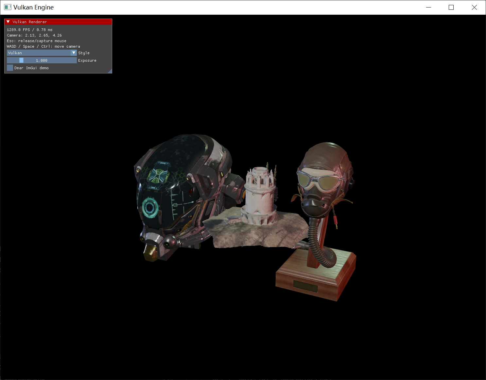
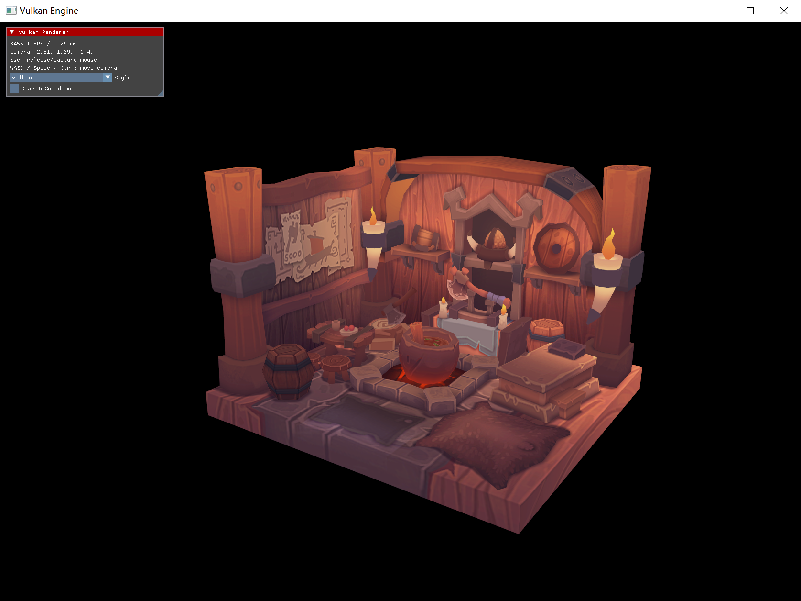

### from vulkan tutorial pdf

##### 使用cmake与vcpkg配置运行程序时需要的依赖包和库
> 根目录下有vcpkg.json文件，使用命令 
vcpkg install
安装依赖，之后部署，得到程序的exe程序后，需要将texture和model放在exe统一目录下才能运行

> 根目录下两个pdf文档为vulkan基础功能的教程文档，英文版为官方文档，中文版为非官方版
- 这个项目在实现过程中的参考链接：
- renderer部分
```bash
https://docs.vulkan.org/tutorial/latest/03_Drawing_a_triangle/00_Setup/00_Base_code.html

```

- engine部分
```bash
https://docs.vulkan.org/tutorial/latest/Building_a_Simple_Engine/introduction.html

```

## 运行效果与运行方式

以下两张图片由项目使用者在本地实际运行本项目后截取，原始截图保存在项目根目录的 `pbr.png` 和 `renderer.png` 中。

请在项目根目录打开 PowerShell 并运行程序，以便正确读取 `models/`、`textures/` 等相对路径下的资源。以下命令以 Debug 构建的 `build/Debug/Engine.exe` 为例；使用其他构建配置时，请替换为对应的可执行文件路径。

### PBR 渲染模式

不传入 `--legacy` 参数时，程序默认使用 PBR 渲染路径：

```powershell
.\build\Debug\Engine.exe
```

图片来源：本项目以默认 PBR 模式运行后的窗口截图，文件为 [`pbr.png`](./pbr.png)。截图中展示了 DamagedHelmet、FlightHelmet 和 Bismarckturm 三个 glTF 模型，通过 `PbrRenderer` 加载模型材质并进行 PBR 渲染。



### 原有 Renderer 渲染模式（--legacy）

传入 `--legacy` 参数，切换到原有的渲染路径：

```powershell
.\build\Debug\Engine.exe --legacy
```

图片来源：本项目以 `--legacy` 模式运行后的窗口截图，文件为 [`renderer.png`](./renderer.png)。该模式使用原有的 `LoadModel` 和 `Pipeline` 加载、渲染 `models/viking_room.obj`，截图中展示了带纹理的 Viking 房间场景。



两种渲染模式通过启动参数选择，每次运行使用其中一种模式。
